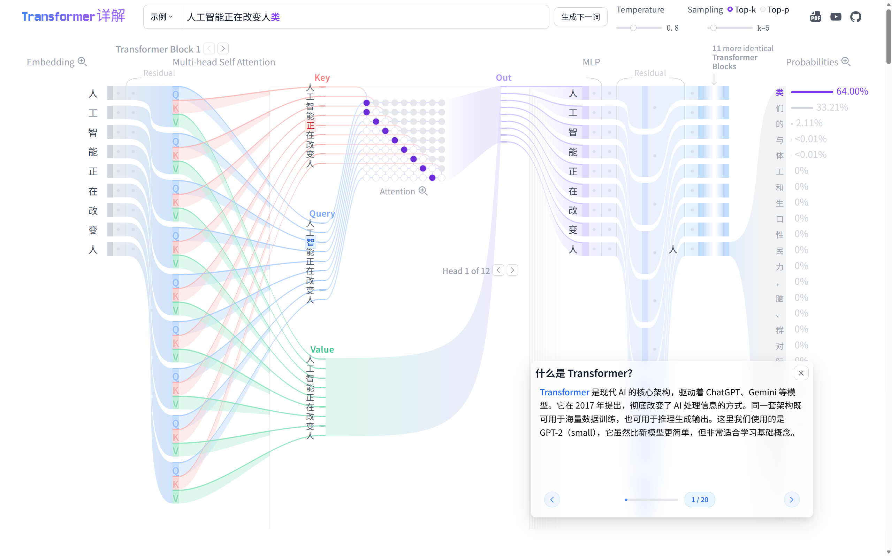

# Transformer Explainer — 中文版

> 基于原项目 [poloclub/transformer-explainer](https://github.com/poloclub/transformer-explainer) 二次开发，将模型替换为中文 GPT-2，并完整适配中文分词、中文示例数据与前端界面。

[](LICENSE)
[](https://github.com/poloclub/transformer-explainer/blob/main/LICENSE)
[](https://www.apache.org/licenses/LICENSE-2.0)



---

## 项目实现了什么

### 核心功能

Transformer Explainer 是一个**交互式 Transformer 可视化工具**，让任何人都能在浏览器中直观理解 GPT 类语言模型的工作原理。

本中文版在原项目基础上，使用**自建 7000 常用字词表**对中文 GPT-2 模型进行重新蒸馏与 **INT4 极限压缩**（模型大小仅为 67.9MB，且内置保存了中间层自注意力激活值），实现如下功能：

- **极速浏览器内推理**：无需后端服务器，模型通过 INT4 压缩，在浏览器端运行更加丝滑轻量
- **自研 7000 精简词表**：废弃了原版 21128 的庞大词表，采用精简的 7000 词表和 138KB 的本地快速分词器，加载极快
- **逐 token 可视化**：输入中文文本后，可视化每个 token 经过 Transformer 各层的完整计算过程
- **自注意力机制可视化**：基于新模型内置输出的真实注意力权重，展示多头自注意力层 Q/K/V 乘积与 Softmax 的完整轨迹
- **MLP 子层可视化**：展示前馈网络的线性变换与激活
- **概率分布与采样**：展示最终 logits 经 temperature 缩放、Top-K 过滤、Softmax 归一化后的 token 概率分布，并可视化采样过程
- **内置中文示例**：提供 5 个预计算的中文示例，支持 0 延迟首屏离线演示（无需等待模型加载与推理）
- **可调参数**：支持在界面上调整 temperature 与 Top-K 参数，实时观察对概率分布的影响

### 可视化的 Transformer 组件

| 组件                 | 可视化内容                                    |
| -------------------- | --------------------------------------------- |
| Token Embedding      | 输入 token 映射为词向量                       |
| Positional Encoding  | 位置编码叠加到词向量                          |
| Multi-Head Attention | Q/K/V 投影、缩放点积、掩码、Softmax、加权求和 |
| Add & Norm           | 残差连接与层归一化                            |
| Feed-Forward (MLP)   | 两层线性变换与 GELU 激活                      |
| Linear & Softmax     | 最终 logits 投影与 token 概率输出             |

---

## 如何实现的

### 技术架构

```
浏览器端
  SvelteKit + TypeScript  ← 前端框架
  ONNX Runtime Web        ← 模型推理引擎（WebAssembly）
  D3.js + GSAP            ← 数据可视化与动画
  Tailwind CSS + SCSS     ← 样式

离线构建（Python）
  PyTorch + Transformers  ← 加载 HuggingFace 权重
  torch.onnx.export       ← 导出 ONNX（opset=11）
  onnxruntime             ← 推理验证
  BertTokenizer           ← 中文分词
```

### 模型运行原理

1. **蒸馏与 INT4 量化**：离线阶段将原始中文 GPT-2 映射至 nanoGPT 骨架，基于 7000 字词表进行压缩，并以 INT4 量化导出为 67.9MB 的 `model_int4.onnx`（内置自注意力权重输出接口）。
2. **单片高性能打包**：为避免过多的分片网络请求开销，最终模型以单分片形式（`gpt2.onnx.part0`）部署在 `static/` 下，前端拉取后直接利用浏览器 Cache API 缓存。
3. **本地分词**：使用本地自建的 `student` 中文快速分词器进行分词，避免远端网络开销。
4. **WASM 线程控制与防抖**：前端执行推理时限制最大使用 4 个 WASM 线程，规避多核 CPU 锁死，并对 SVG 重绘加入 `requestAnimationFrame` 防抖，保障推理与动画的丝滑表现。

### 关键设计决策

**输出张量命名对齐**：导出的 ONNX 输出名称与原项目完全一致（`block_{i}_attn_head_{j}_{suffix}`），因此所有前端可视化组件无需修改。

**权重映射转置**：HuggingFace GPT-2 的 `c_attn` / `c_proj` / `c_fc` 使用 `Conv1D`（权重形状 `[in, out]`），nanoGPT 使用 `nn.Linear`（形状 `[out, in]`），以下 4 组权重在复制时需要转置：

```
attn.c_attn.weight   attn.c_proj.weight
mlp.c_fc.weight      mlp.c_proj.weight
```

**统一配置源**：Python 脚本与前端共享 `model-config.json`，所有参数（层数、头数、词表大小、分片数、缓存版本等）单一来源，避免手动同步。

---

## 快速开始

模型资产已内置于仓库的 `static/model-v2-chinese/` 目录（INT4 压缩版，67.9MB），自建分词器配置位于 `static/tokenizers/student/`，克隆后**无需配置任何 Python 环境**，直接启动前端开发服务器即可。

**前提条件：** Node.js v20+，NPM v10+

```bash
git clone https://github.com/Y-chen3164553757/transformer-explainer-Chinese.git
cd transformer-explainer-Chinese
npm install
npm run dev
```

访问 `http://localhost:5173`，首次打开时浏览器会自动下载并缓存极简模型，之后刷新将直接读取本地缓存。

---

## 我们做了什么 — 自建词表与 INT4 模型接入流程

为了彻底解决中文 GPT-2 原版体积过大（~460MB）以及自注意力轨迹不真实的问题，我们使用**自建的 7000 中文字词表**重新编译了轻量 tokenizer，并将模型做 **INT4 极限压缩量化 (67.9MB)**。转换和预计算逻辑位于 `model_processing/` 目录中：

### 离线处理流程概览

```
model-config.json（唯一配置源，Python 与前端共享）
       │
       ├─── model_processing/01.py ──────────────────► 下载原始中文 GPT-2 权重
       │
       ├─── model_processing/02_convert_onnx.py ─────► 导出原始 ONNX 模型（含 26 个自注意力与隐藏状态节点）
       │
       ├─── model_processing/03_chunk.py ────────────► 拷贝压缩量化后的单片模型至 static/model-v2-chinese/gpt2.onnx.part0
       │
       └─── model_processing/04_gen_examples.py ─────► 预计算 5 个中文提示词例子的自注意力与概率数据
```

| 步骤 | 脚本                   | 核心操作                                                                                                                                                                                           | 输出                                           |
| :--: | ---------------------- | -------------------------------------------------------------------------------------------------------------------------------------------------------------------------------------------------- | ---------------------------------------------- |
|  1  | `01.py`              | 从 HuggingFace 下载 uer 团队的中文 GPT-2 原始权重                                                                                                                                                | `model_processing/models/gpt2-chinese-cluecorpussmall/` |
|  2  | `02_convert_onnx.py` | 映射至 nanoGPT 架构，在 Wrapper 中导出 12 个自注意力层节点，生成未量化的 ONNX 模型                                                                                                               | `model_processing/models/gpt2-chinese-onnx/model.onnx`        |
|  3  | `03_chunk.py`        | 拷贝最终经过 **INT4 量化压缩后的极简模型 (67.9MB)** 到前端静态资源目录，且配置合并为单一分片以优化加载性能                                                                                        | `static/model-v2-chinese/gpt2.onnx.part0` |
|  4  | `04_gen_examples.py` | 对 5 个内置中文例句跑 ONNX 模型推理，预生成各层自注意力头矩阵及概率分布数据，供前端离线渲染，实现首屏瞬间加载                                                                                     | `src/constants/examples/ex0~ex4.js`          |

### 关键细节

**权重转置**：HuggingFace GPT-2 的 `c_attn` / `c_proj` / `c_fc` 使用 `Conv1D`（形状 `[in, out]`），nanoGPT 使用 `nn.Linear`（形状 `[out, in]`），以下 4 组权重复制时需要 `.t()`：

```
attn.c_attn.weight   attn.c_proj.weight
mlp.c_fc.weight      mlp.c_proj.weight
```

`lm_head.weight` 与词嵌入 `wte.weight` 权重共享，HF checkpoint 中不单独存储，脚本自动从 `transformer.wte.weight` 复制。

**输出张量命名对齐**：导出的 ONNX 输出名称与原项目完全一致（`block_{i}_attn_head_{j}_{suffix}`），所有前端可视化组件无需修改。

**采样逻辑对齐**（`04_gen_examples.py` ↔ 前端 `topKSampling`）：

1. logits 按值降序取前 `maxDisplayTokens`（50）个
2. 温度缩放：`scaledLogit = logit / temperature`（默认 0.8）
3. Top-K 过滤：rank ≥ K 的 `topKLogit` 置为 `-Infinity`
4. 对 top-K 做 softmax → 归一化概率
5. 固定随机种子（`sampleSeed = 42`）从 top-K 中采样，保证可复现

---

## 模型来源与自建词表

| 资源                           | 地址                                                    |
| ------------------------------ | ------------------------------------------------------- |
| 中文 GPT-2 权重（原始基础）    | https://huggingface.co/uer/gpt2-chinese-cluecorpussmall |
| 自建中文词表 (Vocab Size=7000) | 蒸馏重构出的 7000 常用简体中文精简字词表                |
| 本地分词器 (student)           | 基于 BertTokenizerFast 序列化结构导出的 138KB 轻量配置  |

---

## 若需重新生成模型资产

若需更换模型或重新生成分片，安装 Python 依赖后在 `model_processing/` 目录下按顺序执行四个脚本：

```bash
pip install torch transformers onnxruntime huggingface_hub

python 01.py                # 下载中文 GPT-2 权重
python 02_convert_onnx.py   # 转换为 ONNX 并验证推理
python 03_chunk.py          # 拷贝量化后的单片模型至 static/
python 04_gen_examples.py   # 生成 5 个中文预计算示例数据
```

---

## 共享配置说明（model-config.json）

| 字段                     | 含义                              | 默认值                               |
| ------------------------ | --------------------------------- | ------------------------------------ |
| `modelId`              | HuggingFace 模型 ID               | `uer/gpt2-chinese-cluecorpussmall` |
| `tokenizerId`          | 使用的分词器 ID                   | `student`（自建精简词表分词器）      |
| `hfMirror`             | HuggingFace 镜像源地址            | `https://hf-mirror.com`            |
| `paths.staticModelDir` | 分片文件写入目录（Python 脚本用） | `static/model-v2-chinese`          |
| `paths.publicModelDir` | 前端请求分片的 URL 前缀           | `model-v2-chinese`                 |
| `runtime.chunkTotal`   | 分片总数，前端与 Python 共享      | `1`（INT4 量化合并为单片以优化性能） |
| `runtime.cacheVersion` | 浏览器缓存版本键，升级模型时递增  | `v4`（全新版本）                     |

---

## 目录结构

```
transformer-explainer-Chinese/
├── model-config.json          # 唯一配置源（Python + 前端共享）
├── model_processing/          # 离线模型转换与推理处理代码
│   ├── 01.py                  # Step 1: 下载模型权重
│   ├── 02_convert_onnx.py     # Step 2: 转换 ONNX
│   ├── 03_chunk.py            # Step 3: 分片打包
│   ├── 04_gen_examples.py     # Step 4: 生成示例数据
│   └── model/                 # 包含量化后的 model_int4.onnx 及 vocab.txt
├── src/
│   ├── routes/                # SvelteKit 页面入口（限制 WASM 线程，优化动画）
│   ├── components/            # 可视化与 D3 连线组件（加入重绘帧防抖）
│   ├── store/                 # 全局状态管理
│   ├── constants/examples/    # 由 04.py 生成的预计算中文示例数据
│   └── utils/model/           # nanoGPT 模型骨架 (model.py)
├── static/
│   ├── model-v2-chinese/      # 最终极简量化单片模型 (gpt2.onnx.part0, 67.9MB)
│   ├── tokenizers/student/    # 自建 7000 词表快速分词器配置文件
│   └── wasm/                  # 本地 onnxruntime-web WASM 依赖，规避 CDN 阻塞
```

---

## 致谢

本项目基于以下两个开源项目构建，向原作者致谢：

**[poloclub/transformer-explainer](https://github.com/poloclub/transformer-explainer)**
由 Georgia Institute of Technology 的 Aeree Cho、Grace C. Kim、Alexander Karpekov、Alec Helbling、Jay Wang、Seongmin Lee、Benjamin Hoover 和 Polo Chau 创作。本项目的前端可视化框架、ONNX 推理管线和交互设计均来源于此。发表于 IEEE VIS 2024。授权协议：MIT License。

**[uer/gpt2-chinese-cluecorpussmall](https://huggingface.co/uer/gpt2-chinese-cluecorpussmall)**
由 Universal Language Model Fine-tuning（UER）团队开源的中文 GPT-2 模型，在 CLUECorpusSmall 数据集上训练，词表大小 21128，12 层 12 头 768 维。本项目使用其权重作为中文推理引擎。授权协议：Apache License 2.0。

---

## License

| Component                                                                                                | License                                                                         |
| -------------------------------------------------------------------------------------------------------- | ------------------------------------------------------------------------------- |
| This project (source code, scripts, docs)                                                                | Proprietary — see[LICENSE](LICENSE)                                               |
| [poloclub/transformer-explainer](https://github.com/poloclub/transformer-explainer)                         | [MIT License](https://github.com/poloclub/transformer-explainer/blob/main/LICENSE) |
| [uer/gpt2-chinese-cluecorpussmall](https://huggingface.co/uer/gpt2-chinese-cluecorpussmall) (model weights) | [Apache License 2.0](https://www.apache.org/licenses/LICENSE-2.0)                  |

The original adaptations, engineering modifications, and new features created by the author are independent original works. Redistribution of the Chinese GPT-2 model weights must comply with the Apache License 2.0.
